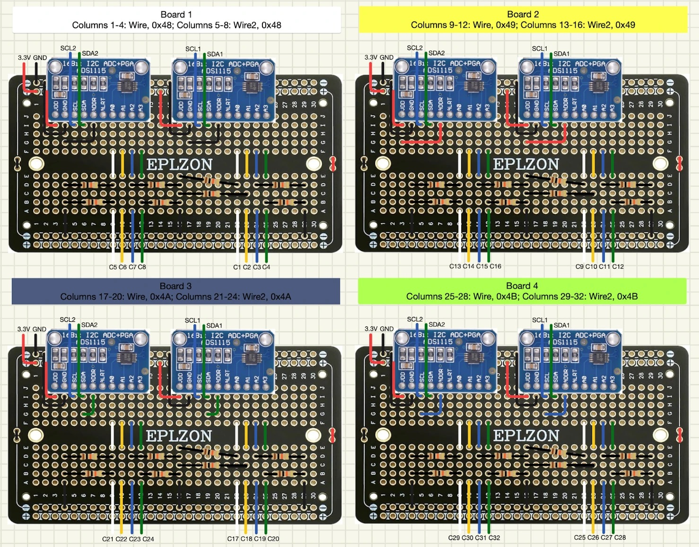
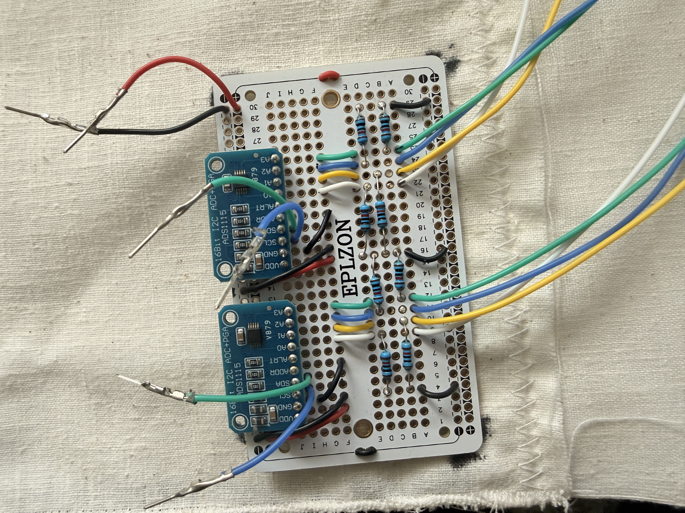

# Pressure Sensor Pad for Real-Time Ulcer Detection
A smart pressure-sensing pad for early detection of pressure ulcers, built at the Tatonetti Lab, Cedars-Sinai.

## Table of Contents
- [Project Overview](#project-overview)
  - [Motivation](#motivation)
  - [Clinical Grounding](#clinical-grounding)
  - [Project History](#project-history)
- [Hardware](#hardware)
  - [Core Components](#core-components)
  - [Sensor Construction](#sensor-construction)
  - [Circuit Summary](#circuit-summary)
  - [Board Layout](#board-layout)
- [Software](#software)
  - [Arduino Firmware](#arduino-firmware)
  - [Wireless Streaming](#wireless-streaming)
  - [Live Heatmap Notebook](#live-heatmap-notebook)
- [Testing and Usage](#testing-and-usage)
  - [Power Supply](#power-supply)
  - [Firmware Upload](#firmware-upload)
  - [Viewing the Data](#viewing-the-data)
  - [Hardware Guide](#hardware-guide)
  - [Incremental Build and Test](#incremental-build-and-test)
- [Current Results](#current-results)
- [Current Limitations](#current-limitations)
- [Critical Build Notes](#critical-build-notes)
- [Roadmap](#roadmap)
- [Troubleshooting Guide](#troubleshooting-guide)
- [File Structure](#file-structure)
- [Authors](#authors)

## Project Overview
This project is a custom-built pressure sensor pad designed to detect and monitor pressure distribution in surgical and ICU settings. The goal is to identify high-risk regions for pressure ulcers in real time and guide timely repositioning of hospitalized patients.

### Motivation
Pressure ulcers (bedsores) are common in ICU and surgical patients and drive up infections, length of stay, and cost of care. The current standard of care relies on manual turning schedules or subjective monitoring, with no continuous, objective feedback for nurses or physicians. This device aims to close that gap by:
- Continuously monitoring pressure points beneath a patient
- Alerting clinicians to prolonged or high-risk pressure areas
- Guiding repositioning before tissue damage begins: **pad detects hotspot → clinician is alerted → patient is repositioned**

### Clinical Grounding
- Capillary closing pressures: arterial ~32 mmHg, venous 8 to 12 mmHg
- Interface pressure ranges vary by anatomical site and patient position; common supine sites are the head, shoulders, elbows, buttocks/sacrum, legs and heels
- Injury risk follows an inverse pressure/time relationship, so **pressure-time integration, not instantaneous pressure, is the clinically meaningful signal**
- NPUAP/EPUAP staging is the injury staging framework in use
- Braden Scale subscales are a potential source of metadata for alert weighting
- Deep Tissue Injury (DTI) is a distinct and particularly dangerous subcategory that surface sensors cannot directly detect

### Project History
The pad has gone through three read architectures. Earlier designs are kept in [`OLD/`](OLD) for reference.

| Version | Sensor layer | Read architecture | Outcome |
|---|---|---|---|
| Early 2025 prototype | Conductive thread on Velostat | `74HC4051` multiplexers + denoising autoencoder | High crosstalk and slow switching; the autoencoder could not compensate for the noise |
| Summer 2025 | 23 × 32 conductive-thread grid (736 cells) | `ADG728` I2C analog switches on a custom `KiCad` PCB, one cell at a time on the GIGA's onboard ADC; LVGL UI on the GIGA Display Shield | Full scan took ~15 to 37 s; PCB assembly issues left the board unusable; thread made only point contact with the Velostat |
| Summer 2026 (current) | Conductive fabric strips | 8 × `ADS1115` ADCs on two I2C buses, rows driven directly from GPIO | Reads 8 points at a time; estimated ~0.75 s full-pad scan (20 to 50 × faster) |

<p align="center">
  
  <br>
  <em>Summer 2025 (legacy): custom ADG728 multiplexer PCB with the GIGA Display Shield</em>
</p>

## Hardware

### Core Components
- **Microcontroller:** `Arduino GIGA R1 WiFi`
- **Sensor Matrix:** Grid of row and column strips over `Velostat`, a piezoresistive plastic that changes resistance under pressure (see [Sensor Construction](#sensor-construction) for dimensions)
- **Electrodes:** Conductive fabric strips (copper/nickel ripstop, under 0.03 ohm sheet resistance), which give full-area contact at every intersection
- **ADCs:** Eight `ADS1115` 16-bit I2C ADCs across two independent I2C buses, 4 channels each, for 32 columns in total
- **Boards:** Four solderable protoboards, two ADS1115 chips per board
- **Connections:** 5mm sewable snaps attached with stainless conductive thread, 28AWG silicone wire. Snaps give a removable, solderable connection point without applying heat to the fabric
- **Networking:** Portable router on WPA2-Personal, UDP streaming to a host machine

> The previous design used `ADG728` analog switches on a custom `KiCad` PCB to scan one cell at a time. Both the multiplexers and the custom PCB have been removed from the design. The schematic and PCB PDFs in [`Docs/`](Docs) describe that legacy design.

### Sensor Construction
The pad is a three-layer sandwich, with no stitching anywhere in the sensing path:

| Layer | Contents |
|---|---|
| Top cover | Row strips sewn onto a separate fabric cover |
| Center | Velostat sheet, mechanically fixed in place |
| Bottom cover | Column strips sewn onto a separate fabric cover |

Strip geometry:

| | Columns | Rows |
|---|---|---|
| Count | 34 | 24 |
| Strip width | 1.0 cm | 1.0 cm |
| Gap between strips | 1.5 cm | 1.5 cm |
| Pad dimension | ~86 cm | ~60 cm |

> The ADC array reads 32 columns (8 chips × 4 channels), so two of the 34 cut column strips have no ADC channel in the current design.

Strips are sewn onto the cover layers, never through the Velostat itself. See [Critical Build Notes](#critical-build-notes) for why.

### Circuit Summary
- One row at a time is driven HIGH directly from a GIGA digital pin
- All unselected rows are set to high-impedance (`INPUT`), not LOW
- Each column line forms a voltage divider with a 10 kohm pull-down to GND
- The ADS1115 chips read the column voltages, eight points at a time across the two buses
- Pressure lowers the Velostat resistance at the intersection, raising the column voltage

Typical response at a single cell:

| State | Voltage at column node |
|---|---|
| No pressure | ~0.3 to 0.5 V |
| Full pressure | ~3.2 V |

> Because rows are driven directly from GPIO, no multiplexers are required. The GIGA has 76 digital pins and the full design needs 24 for rows plus 4 for the two I2C buses.

### Board Layout
Each protoboard carries two ADS1115 chips, one on each I2C bus, sharing an address.

| Board | Bus / Address | Columns | ADDR pin wired to |
|---|---|---|---|
| Board 1 | Wire, 0x48 | 1 to 4 | GND |
| Board 1 | Wire2, 0x48 | 5 to 8 | GND |
| Board 2 | Wire, 0x49 | 9 to 12 | VDD |
| Board 2 | Wire2, 0x49 | 13 to 16 | VDD |
| Board 3 | Wire, 0x4A | 17 to 20 | SDA |
| Board 3 | Wire2, 0x4A | 21 to 24 | SDA |
| Board 4 | Wire, 0x4B | 25 to 28 | SCL |
| Board 4 | Wire2, 0x4B | 29 to 32 | SCL |

Chips on separate buses may share an I2C address without conflict. Board 1 (the white board, columns 1 to 8) is fully assembled and serves as the reference example for wiring the other three.

<p align="center">
  
  <br>
  <em>Wiring diagram for all four boards: power, both I2C buses, ADDR jumpers, 10 kohm pull-downs and column outputs</em>
</p>

<p align="center">
  
  <br>
  <em>Board 1 (columns 1 to 8), the assembled reference board</em>
</p>

<p align="center">
  
  <br>
  <em>All four boards wired in parallel on the shared 3.3V, GND, Wire and Wire2 lines</em>
</p>

**Arduino GIGA R1 WiFi I2C pin assignments:**

| Bus | SDA | SCL |
|---|---|---|
| `Wire` | pin 20 | pin 21 |
| `Wire2` | pin 9 | pin 8 |

> `Wire2` is not labelled as I2C on the GIGA silkscreen. Wiring it to pins 11/12 or 101/102 will fail to find the chip.

## Software

### Arduino Firmware
The current sketch is [`pressure_pad_data/pressure_pad_data.ino`](pressure_pad_data/pressure_pad_data.ino). It:
- Drives one row at a time from GIGA digital pins, holding all other rows high-impedance
- Reads all active column channels over both I2C buses
- Times each full scan and reports the measured duration
- Streams results over WiFi and prints the grid to Serial as a fallback

Configuration at the top of the sketch:

| Setting | Default | Purpose |
|---|---|---|
| `WIFI_SSID` / `WIFI_PASS` | lab router | Credentials of the portable router, not the hospital network |
| `USE_BROADCAST` | `1` | `1` sends to the subnet broadcast address; `0` sends to `targetIP` only |
| `UDP_PORT` | `4210` | Port the host listens on |
| `NUM_COLS` / `NUM_ROWS` | `12` / `5` | Size of the wired grid |
| `rowPins[]` | `{2, 3, 4, 5, 6}` | GIGA pins driving each row; extend as rows are added (up to 24) |
| `SERIAL_DEBUG` | `1` | `1` also prints the grid to Serial, `0` is UDP only |
| `FRAME_DELAY` | `100` ms | Pause between full scans |

The firmware uses preprocessor `#if` blocks keyed to `NUM_COLS`, incrementing by 4 per chip, so the reads in `readRow()` match the chips that are physically installed and the system can be built and tested incrementally.

> `setup()` currently calls `begin()` only for the first three chips (columns 1 to 12). When raising `NUM_COLS` above 12, add the matching `begin()` call for each new chip in `setup()` as well, following the existing Board 2 `Wire` block.

### Wireless Streaming
The pad joins a portable router running WPA2-Personal. Hospital networks typically use WPA2-Enterprise, which the GIGA does not support natively, so a dedicated router avoids the authentication problem entirely.

Data is sent as UDP packets, one packet per scanned row, which keeps every payload well under the MTU. A dropped packet costs one row rather than an entire frame. By default packets go to the subnet broadcast address (for example `192.168.8.255`), so the host does not need a fixed IP.

```
FRAME,<frameId>,<rows>,<cols>,<scanTimeMs>
ROW,<frameId>,<rowIndex>,v0,v1,...,vN
END,<frameId>
```

`rowIndex` is 0-based, values are column voltages with 3 decimals, and `scanTimeMs` is the measured duration of the previous full scan.

A WiFi failure is non-fatal. The pad continues scanning and printing to Serial, and retries the connection in `loop()`.

### Live Heatmap Notebook
[`pressure_pad_data/adc_visualization.ipynb`](pressure_pad_data/adc_visualization.ipynb) renders a live voltage heatmap of the grid on the host machine.

| Path | Transport | Cells to run |
|---|---|---|
| Primary | WiFi UDP, port 4210 | WiFi Config → WiFi Heatmap |
| Fallback | USB Serial, 115200 baud | Wired Config → Serial Diagnostics (optional) → Wired Heatmap |

`NUM_ROWS` and `NUM_COLS` in the notebook must match the sketch. Requires `pyserial`, `numpy` and `matplotlib` (installed by the first cell).

## Testing and Usage

### Power Supply
- Arduino: USB-C or external 5V line
- Router: USB-C power bank or wall outlet

### Firmware Upload
1. Install the **Arduino Mbed OS GIGA Boards** package in the [**`Arduino IDE`**](https://www.arduino.cc/en/software/) Boards Manager
2. Install the `Adafruit ADS1X15` library from the Library Manager (`Wire`, `WiFi` and `WiFiUdp` ship with the board package)
3. Open `pressure_pad_data/pressure_pad_data.ino`
4. Set `WIFI_SSID` and `WIFI_PASS` to the portable router credentials
5. Set `NUM_COLS`, `NUM_ROWS` and `rowPins[]` to match the hardware currently installed
6. Connect the `Arduino GIGA R1 WiFi` via USB, select the board and port, and upload (target the main `M7` core)

### Viewing the Data
1. Connect the host laptop to the same portable router as the pad
2. Open `pressure_pad_data/adc_visualization.ipynb` and run the install cell
3. Run **WiFi Config**, then **WiFi Heatmap**
4. If WiFi is unavailable, connect over USB and use the wired cells instead

### Hardware Guide
1. Position the pad with the connection tabs accessible along the row and column edges
2. Connect each column strip to its assigned ADS1115 analog input through its snap and wire
3. Connect each column line to GND through a 10 kohm pull-down resistor
4. Connect each row strip to its assigned GIGA digital pin
5. Wire both I2C buses from the GIGA to all four protoboards in parallel, sharing 3.3V and GND
6. Confirm each board's ADDR pins are set per the [Board Layout](#board-layout) table
7. Power the board

### Incremental Build and Test
Build up the pad in groups of four columns. After wiring each new chip:

1. Set `NUM_COLS` to the new total, add the chip's `begin()` call in `setup()` if it is not there yet, and re-upload
2. Confirm the startup Serial output reports the new chip as found
3. Press each new cell individually and confirm only its column responds
4. Press two cells in the same column and confirm both register independently

Step 4 is the one that catches row isolation faults, which do not appear in single-point testing.

## Current Results
- Dual-bus parallel ADC architecture validated; reads 8 points at a time instead of 1
- A 12 column × 5 row test section, hand-sewn directly to the Velostat, confirmed working with correct multi-point discrimination
- Clean pressure response and return to baseline across all tested cells
- No ghosting between rows or columns
- Conductive fabric strips solved the contact-reliability problem of conductive thread
- Wireless UDP streaming and a live host-side heatmap implemented
- Test deployment planned at a Cedars-Sinai surgical suite

## Current Limitations
- Only the 12 × 5 test section is wired and validated. It was sewn directly to the Velostat, which distorts readings and is not viable long-term; the three-layer cover design replaces it
- Remaining strips are cut and sewing positions are marked on the covers, but sewing is not yet complete
- Firmware has been validated on the 12 × 5 subset only and still needs scaling to the full grid
- Baseline resting voltage varies between strips, so per-cell calibration will be needed for cross-pad comparison
- Data is real-time only; pressure history is not yet stored
- Alert logic is not yet implemented
- The Arduino still requires a wired power source, so the system is not yet fully untethered
- Velostat must be handled carefully to avoid flex damage
- The conductive fabric contains nickel and should not contact patient skin directly; a non-conductive cover layer is required for clinical use

## Critical Build Notes
These are failure modes that cost significant debugging time. They are not obvious and are easy to reintroduce.

| Finding | Why it matters |
|---|---|
| The bare fabric face must contact the Velostat | Conductive tape adhesive insulates against Velostat even when the tape itself is conductive. Readings appear stable but do not respond to pressure. |
| Unselected rows must be `INPUT`, never `LOW` | Driving unselected rows LOW creates phantom current paths through pressed cells. Single-point readings look correct; multi-point readings are corrupted. |
| Velostat must be mechanically fixed | It shifts under load and can short the two fabric layers, collapsing resistance to zero. |
| Never sew strips through the Velostat along their length | The stitching compresses the material and corrupts the pressure signal. Sew strips onto cover layers instead. |
| Use fabric strips, not conductive thread, as electrodes | Thread makes only point contact with the Velostat, so readings are inconsistent from cell to cell. |

## Roadmap

| Milestone | Status |
|---|---|
| Initial prototype | Complete |
| Parallel ADC architecture | Complete |
| Conductive fabric sensor layer | Complete |
| Wireless data streaming | Complete |
| Real-time heatmap visualization (host notebook) | Complete |
| Full pad assembly: sew strips onto covers, attach covers to the Velostat, solder strips to the boards | In progress |
| Scale firmware to the full grid | Planned |
| Battery power for full wireless operation | Planned |
| Historic data logging and alert logic | Planned |
| Clinical suite testing | Planned |

## Troubleshooting Guide

| Problem | Possible Cause | Solution |
|---|---|---|
| Nothing printed to Serial | Sketch halted in setup on a chip that was not found | Check the last Serial line before the halt to identify which chip failed |
| `ERROR: BoardN Wire2 chip not found` | SDA/SCL on the wrong pins | `Wire2` is SDA pin 9, SCL pin 8. It is not labelled on the silkscreen |
| New columns read garbage or hang after raising `NUM_COLS` | The new chip's `begin()` call is missing from `setup()` | Add the `begin()` block for that chip, matching its bus and address |
| Chip found but readings do not respond to pressure | Column wires on the wrong AIN channels | Verify the physical AIN channel matches the channel index in `readRow()` |
| Readings stable but unresponsive to pressure | Adhesive side of the electrode contacting the Velostat | Reorient so the bare fabric face is the contact surface |
| Resistance drops to 0 ohm under light pressure | Velostat shifting, allowing the fabric layers to touch | Fix the Velostat in place relative to the cover layers |
| Voltage drops when pressing multiple cells in one column | Unselected rows driven LOW instead of high-impedance | Set all unselected rows to `pinMode(pin, INPUT)` |
| One column always reads high or low | Missing or disconnected 10 kohm pull-down | Verify the pull-down connects the column line to GND |
| Two chips conflict on one bus | Duplicate I2C address | Check ADDR wiring against the Board Layout table |
| No UDP data received | Host and pad on different networks, or firewall blocking the port | Confirm both are on the portable router and that UDP 4210 is open on the host |
| Heatmap shows no data or skips rows | `NUM_ROWS`/`NUM_COLS` in the notebook do not match the sketch | Set both to the values in the `.ino` |
| Arduino not recognized in IDE | Wrong port or missing board package | Select the correct port and install the GIGA board package |
| Red LED flashing after upload | Firmware crash or memory overflow | Double-press the RST button to enter bootloader mode and re-upload |

## File Structure
<pre>
pressure_pad/
├── pressure_pad_data/                 # Current system
│   ├── pressure_pad_data.ino          # GIGA firmware: parallel ADC scan + UDP streaming
│   └── adc_visualization.ipynb        # Live heatmap over WiFi/UDP or USB serial
├── Docs/                              # Presentation and legacy schematic/PCB PDFs
│   └── *.pdf
├── Assets/                            # Images for documentation
│   └── *.png, *.jpg
└── OLD/                               # Previous designs, kept for reference
    ├── PCB/                           # KiCad project for the ADG728 board
    └── DenoisingAutoencoder_OLD/      # Earlier firmware, notebooks and ML work
        ├── PressurePadApp/            # ADG728 firmware + LVGL Display Shield UI
        ├── 6x6/                       # 6x6 prototype models and data
        ├── no_touch_set/
        ├── *.ipynb
        └── pressure_pad_study.db
</pre>

## Authors

- [@AlexAhitov](https://github.com/AlexAhitov)

<p align="center">
  
</p>

[**Back to the top**](#pressure-sensor-pad-for-real-time-ulcer-detection)
